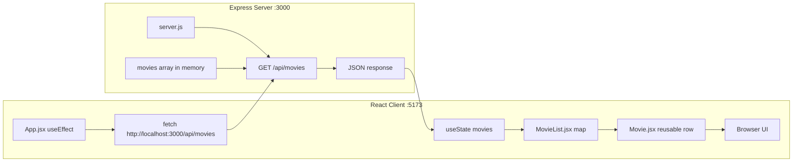

# Project Notes

## Current Project

- Name: WEBD172 Week 7 Task/Movie Manager
- Frontend: React + modern build tool
- Backend: Express
- Current app view buttons: Movies, About

## Run Commands

### Backend

1. Open terminal in `server`
2. Run: `npm start`
3. Server URL: `http://localhost:3000`

### Frontend

1. Open terminal in `client`
2. Run: `npm run dev`
3. App URL: `http://localhost:5173`

## API Endpoints

- `GET /api`
- `GET /api/movies`
- `GET /api/movies/:id`

## API Response Format

- The Express API returns JSON data.
- `GET /api` returns a JSON object with API info and route links.
- `GET /api/movies` returns a JSON array of movie objects.
- `GET /api/movies/:id` returns a single movie object.
- If a movie is not found, `GET /api/movies/:id` returns a JSON error message.

## Frontend to Backend Connection

- The React app connects to the Express server using `fetch()`.
- In `client/src/App.jsx`, it calls `fetch("http://localhost:3000/api/movies")` to load movie data.

## Initial Data Load Behavior

- When the React component first loads, `useEffect()` requests the movie data.
- In `client/src/App.jsx`, the `useEffect(..., [])` hook runs on initial mount and triggers the API request.

## useState and API Responsibilities

- `useState()` stores movie data in frontend React state (browser memory) after it is fetched.
- The Express API is responsible for returning JSON movie data from the backend.
- In this project, backend movie data is stored in an in-memory array on the server, while `useState()` keeps the client-side copy for rendering and interaction.

## Rendering API Data

- The app renders API movie data using `map()`.
- In `client/src/components/MovieList.jsx`, `movies.map(...)` creates the list output.
- Each movie row is rendered through the reusable `Movie` component in `client/src/components/Movie.jsx`.

## Movie Diagram



### How it looks in the browser

1. React loads and calls `GET /api/movies`.
2. Express returns movie data as JSON.
3. React stores it in state and renders the list.
4. The browser shows movie rows (title/year), filters, and controls.

## Suggested Project Structure (Course Example)

```text
homework7-course-directory/
├── server/
│   ├── server.js
│   └── package.json
└── client/
    ├── src/
    │   ├── App.jsx
    │   ├── CourseCard.jsx
    │   └── App.css
    └── package.json
```

## Current Project Structure (This Repo)

```text
WEBD172_Week7_Task_Manager/
├── server/
│   ├── server.js
│   └── package.json
└── client/
    ├── src/
    │   ├── App.jsx
    │   ├── main.jsx
    │   ├── styles.css
    │   └── components/
    │       ├── About.jsx
    │       ├── Header.jsx
    │       ├── Movie.jsx
    │       ├── MovieFilter.jsx
    │       ├── MovieForm.jsx
    │       ├── MovieList.jsx
    │       └── MovieSummary.jsx
    └── package.json
```

## Chat Change Log

- Converted UI wording from Task to Movie.
- Added About view with image gallery and image styling.
- Added Instructions page, then later removed it when no longer needed.
- Renamed/replaced components with movie-based naming:
  - `MovieForm.jsx`
  - `MovieSummary.jsx`
  - `MovieFilter.jsx`
  - `MovieList.jsx`
  - `Movie.jsx`
- Switched React fetch from `/api/tasks` to `/api/movies`.
- Added API base route `GET /api`.
- Enabled CORS in Express for cross-port requests.
- Removed unused legacy `client/src/script.js`.
- Verified project behavior with API checks and client builds.

## Cleanup

- Removed unused root `node_modules`.
- Removed old root `package.json` and `package-lock.json`.
- Removed obsolete `Task` component files and references that were no longer used.
- Removed Instructions component and related styles after de-scoping.

## Verification Checklist

- Express Server exists in `server/server.js`.
- API routes exist: `GET /api`, `GET /api/movies`, `GET /api/movies/:id`.
- React client connects to API with `fetch()` in `client/src/App.jsx`.
- React client stores API data in `useState()` and displays it through `MovieList.jsx` and `Movie.jsx`.
- Expected flow works: app mounts → `useEffect` fetches data → state updates → UI renders movies.
